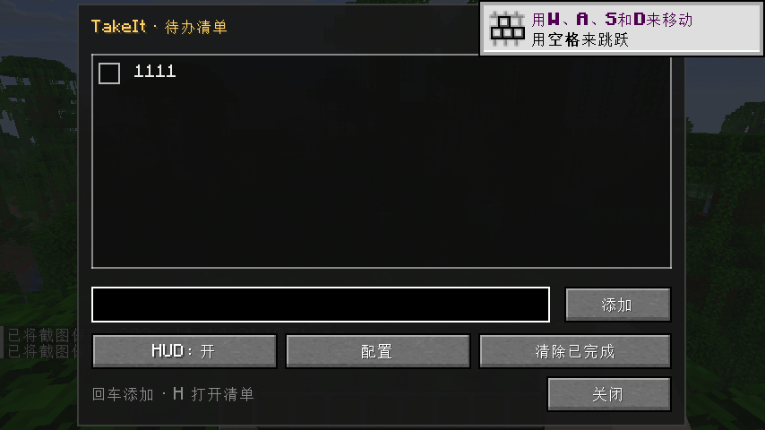
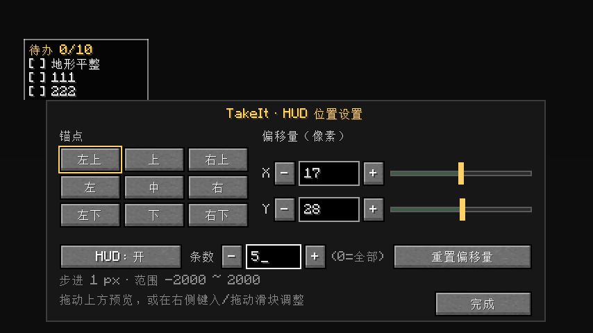
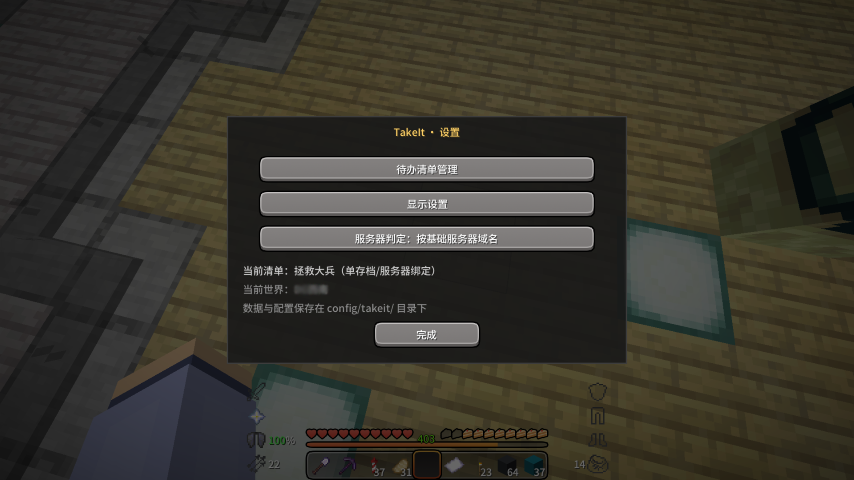
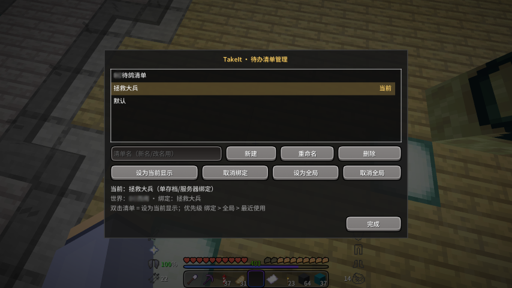

# TakeIt Todo List

客户端待办清单模组：使用DeepSeek开发（赞美大肥鱼，现在AI太成熟了，生成模组后我只对极少量的代码进行了修改）。

## 环境要求

| 项目 | 版本 |
|---|---|
| 模组 ID | `takeit_todo` |
| Minecraft | 26.2 |
| Fabric Loader | 0.20.1+ |
| Fabric API | 任意 26.2 版本 |
| Java | 25 |
| Mod Menu | 可选（20.0.3+） |


## 使用

- 默认按 **H** 打开待办清单（可在「选项 → 控制 → 按键绑定 → TakeIt」修改）；
- 列表里回车添加、点勾选框完成、鼠标悬停在行上点右侧红色的 **X** 删除；
- 「清除已完成」一键清理；
- 界面底部「HUD：开/关」控制 HUD 显示，「配置」进入设置菜单；
- 安装Mod Menu后，可通过模组列表里的 **配置** 按钮进入设置菜单。

### 截图

| 待办清单 | HUD 位置设置 |
|---|---|
|  |  |

| 配置菜单 | 清单管理 |
|---|---|
|  |  |

## 多清单与显示规则

- **一份清单一个文件**，可以建任意多份（上限 500 条/份）；
- 每份清单可以**绑定到某个存档或服务器**，也可以设为全局清单；
- 当前显示的清单按 `绑定 → 全局 → 最近使用 → 默认` 的顺序进行选择；
- **HUD 只在「当前存档/服务器有绑定清单，或存在全局清单」时显示**，否则不显示。

## HUD 设置

- 可在「显示设置 → HUD 位置设置」中选择 9 个锚点（左上、正上、……、右下）快速调整位置，在输入框/滑块/± 微调整数偏移（1px 步进）微调，也可以直接在界面上**拖动**预览；
- 显示条数支持自定义（0 = 全部）；
- 位置配置保存在 `config/takeit_todo/hud_position.json`。

## 配置文件

全部在 `config/takeit_todo/`，手动编辑后重新进入世界即生效：

> 从旧版本（模组 ID 为 `takeit`）升级时，首次启动会把整个 `config/takeit/` 目录改名为
> `config/takeit_todo/`，清单、绑定、HUD 位置与黑名单都原样保留。

```
config/takeit_todo/
├── settings.json       # HUD 开关、显示条数、全局清单、最近使用、服务器判定模式、服务器黑名单
├── bindings.json       # 存档/服务器 → 清单名
├── hud_position.json   # 锚点 + 偏移量
└── lists/
    └── todo_<清单名>.json
```


### 服务器黑名单

支持在 `settings.json` 设置禁用待办名单的服务器（无法通过快捷键打开菜单），添加事例如下：

```json
"serverBlacklist": ["mc.example.com", "play.bad.net:25565"]
```

黑名单使用完整服务器地址，不支持基础服务器域名匹配。  
ps. 写完readme突然觉得这个功能没什么必要（  

## 构建

```bash
./gradlew build        # 产物在 build/libs/
./gradlew runClient    # 起一个带模组的开发客户端
```

Windows 使用 `gradlew.bat`。

## 许可

GNU Lesser General Public License v3.0（SPDX：`LGPL-3.0-only`），全文见 [LICENSE](LICENSE)。

- 你可以自由使用、修改、再分发本模组，包括放进整合包（可闭源），**无需**公开自己的代码；
- 若分发的是**修改过的本模组**，修改部分必须同样以 LGPL-3.0 提供源码；
- 分发时需附带本许可证与版权声明。

