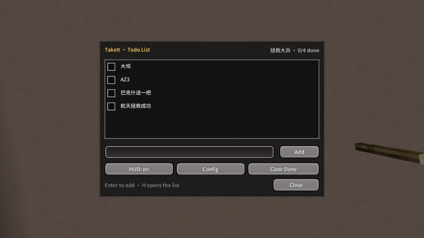
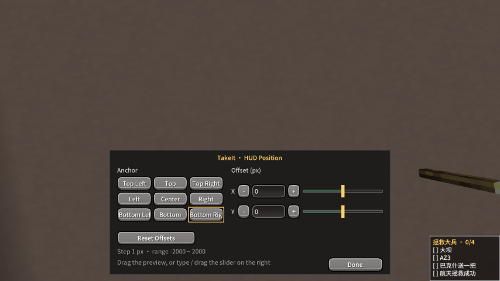
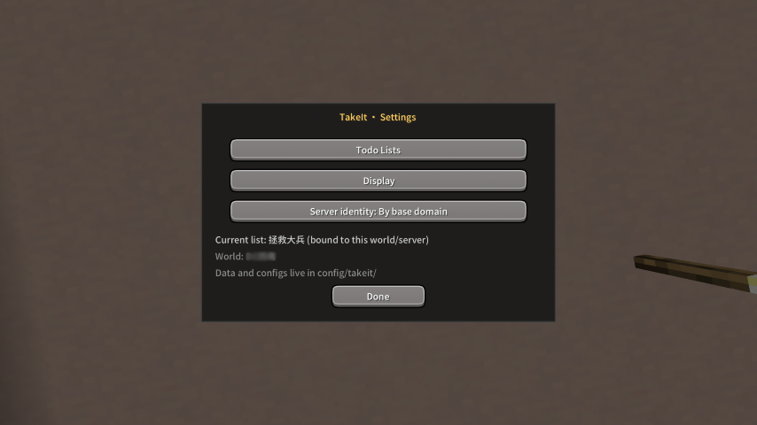
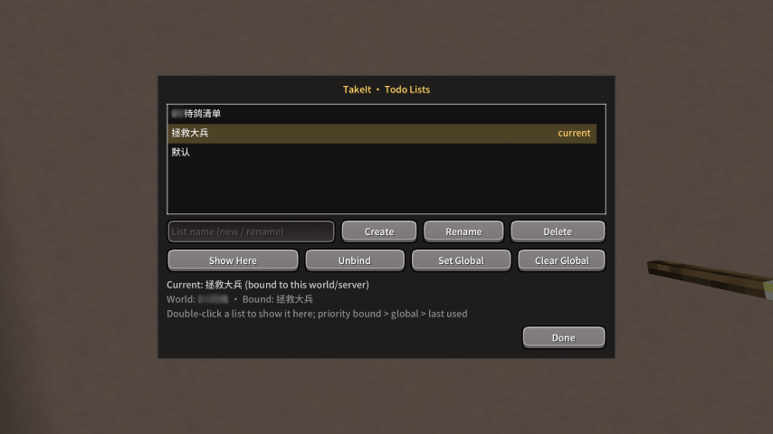

[中文](README.md)

# TakeIt Todo List

A client-side todo list mod: developed with DeepSeek (praise! — AI is so mature now that I only modified a very small amount of the code after generating the mod).

## Requirements

| Item | Version |
|---|---|
| Minecraft | 26.2 |
| Fabric Loader | 0.20.1+ |
| Fabric API | Any 26.2 version |
| Java | 25 |
| Mod Menu | Optional (20.0.3+) |


## Usage

- By default, press **H** to open the todo list (can be changed in "Options → Controls → Key Binds → TakeIt");
- In the list, press Enter to add, click the checkbox to complete, and hover over a row then click the red **X** on the right to delete;
- "Clear Completed" removes all completed items in one click;
- The "HUD: On/Off" button at the bottom of the screen controls HUD visibility, and "Config" opens the settings menu;
- After installing Mod Menu, you can open the settings menu via the **Config** button in the mod list.

### Screenshots

| Todo List | HUD Position Settings |
|---|---|
|  |  |

| Config Menu | List Management |
|---|---|
|  |  |

## Multiple Lists and Display Rules

- **One file per list**; you can create as many lists as you like (limit 500 entries per list);
- Each list can be **bound to a specific save or server**, or set as a global list;
- The currently displayed list is chosen in the order `binding → global → most recently used → default`;
- **The HUD is shown only when "the current save/server has a bound list, or a global list exists"**; otherwise it is hidden.

## HUD Settings

- In "Display → HUD Position" you can pick one of 9 anchors (top-left, top-center, …, bottom-right) to position the HUD quickly, fine-tune the integer offset (1px steps) with the input box/slider/± buttons, or **drag** directly on the preview in the screen;
- The number of displayed entries is customizable (0 = show all);
- The position config is saved in `config/takeit_todo/hud_position.json`.

## Configuration Files

Everything lives in `config/takeit_todo/`; manual edits take effect the next time you enter a world:

> When upgrading from an older version (mod ID `takeit`), the first launch renames the entire `config/takeit/` directory to
> `config/takeit_todo/`, keeping lists, bindings, HUD position, and the blacklist intact.

```
config/takeit_todo/
├── settings.json       # HUD toggle, entry count, global list, most recently used, server detection mode, server blacklist
├── bindings.json       # save/server → list name
├── hud_position.json   # anchor + offset
└── lists/
    └── todo_<list name>.json
```


### Server Blacklist

You can disable the todo list on specific servers in `settings.json` (the menu cannot be opened via the hotkey there). An example entry:

```json
"serverBlacklist": ["mc.example.com", "play.bad.net:25565"]
```

The blacklist uses full server addresses and does not support matching by bare server domain.  
P.S. After finishing the readme I suddenly felt this feature isn't really necessary.

## Building

```bash
./gradlew build        # output in build/libs/
./gradlew runClient    # start a development client with the mod
```

On Windows use `gradlew.bat`.

## License

GNU Lesser General Public License v3.0 (SPDX: `LGPL-3.0-only`); the full text is in [LICENSE](LICENSE).

- You may freely use, modify, and redistribute this mod, including bundling it in modpacks (which may be closed-source), **without** having to publish your own code;
- If what you distribute is a **modified version of this mod**, the modified parts must likewise be provided as source under LGPL-3.0;
- Distribution must include this license and the copyright notice.
